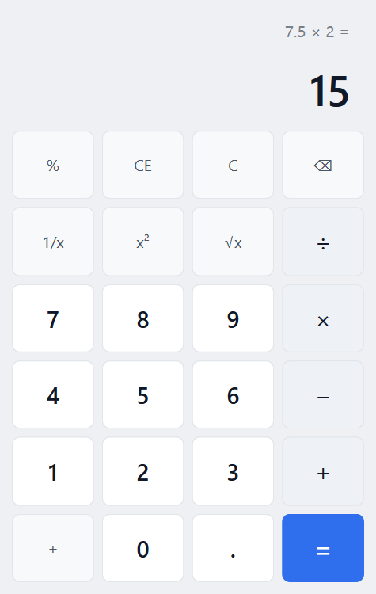

# 带键盘事件的计算器（Qt Widgets）

Qt 应用程序开发 · 实验一。使用 Qt Widgets + Designer 界面文件实现一个同时支持鼠标与键盘的
四则运算计算器，界面参考 Windows 11 计算器。



## 功能

- 四则运算：`+`、`−`、`×`、`÷`，支持连续运算（`2+3+4` 边输入边计算）
- 小数输入：同一操作数只允许一个小数点；整数部分为空时自动补 `0`
- 清除：`C` 全部清除，`CE` 只清除当前操作数
- 退格：`⌫` 只作用于正在输入的第二个操作数，结果状态不会误改
- 正负号 `±`、百分号 `%`、倒数 `1/x`、平方 `x²`、开方 `√x`
- 异常处理：除数为 0 显示“不能除以零”，负数开方显示“无效输入”，出错后输入数字自动开始新计算
- 键盘与鼠标复用同一套处理逻辑，键盘输入时对应按钮会闪烁反馈
- 长数字自动缩小字号，始终完整显示
- 样式表（QSS）统一管理外观，界面与逻辑分离

## 目录结构

```
Calculator/
├── CMakeLists.txt          # 构建脚本（Qt6 + CMake）
├── src/
│   ├── main.cpp            # 程序入口，加载样式表
│   ├── calculator.h/.cpp   # 主窗口：输入分发、显示刷新
│   ├── calculator.ui       # Designer 界面文件（QVBoxLayout + QGridLayout）
│   ├── calculatorengine.h/.cpp  # 与界面无关的计算状态机
│   └── style.qss           # 样式表（以资源形式编译进程序）
├── tests/
│   └── tst_calculatorengine.cpp # QtTest 单元测试（25 个用例）
└── shots/                  # 运行截图
```

## 构建与运行

要求：Qt 6.9.2 及以上（本机验证使用 Qt 6.11.2 + MSVC 2022 x64），CMake 3.21+。

```powershell
cmake -S . -B build -G "Visual Studio 17 2022" -A x64 -DCMAKE_PREFIX_PATH="D:/Qt/6.11.2/msvc2022_64"
cmake --build build --config Release
.\build\Release\Calculator.exe
```

也可以直接用 Qt Creator 打开 `CMakeLists.txt` 后点击运行。

生成可直接分发的程序目录（复制 Qt 运行时 DLL）：

```powershell
cmake --build build --config Release --target deploy
```

## 键盘映射

| 按键 | 功能 |
| --- | --- |
| `0`–`9`（含小键盘） | 输入数字 |
| `.` 或 `,` | 小数点 |
| `+` `-` `*` `/` | 四则运算符 |
| `Enter` / `=` | 求值 |
| `Backspace` | 退格 |
| `Delete` | CE（清除当前输入） |
| `Esc` | C（全部清除） |
| `%` | 百分号 |
| `F9` | 正负号 |
| `R` | 倒数 |
| `Q` | 平方 |
| `S` | 开方 |

## 状态机设计

`CalculatorEngine` 用一组显式状态管理输入，避免界面层散落判断：

| 状态 | 含义 | 进入方式 |
| --- | --- | --- |
| `FirstOperand` | 正在输入/已有第一个操作数 | 启动、清除、结果后直接输入数字 |
| `SecondOperand` | 已按运算符，正在输入第二个操作数 | 按下 `+ − × ÷` |
| `Result` | 已求值，显示结果 | 按下 `=` 或一元运算 |
| `Error` | 出错，显示错误信息 | 除零、负数开方、结果溢出 |

关键成员：`m_accumulator`（第一个操作数/中间结果）、`m_pendingOp`（待定运算符）、
`m_current`（当前显示文本）、`m_secondOperandReady`（第二个操作数是否就绪，用于连续运算）、
`m_lastOp`/`m_lastOperand`（连续按等号时重复上一次运算）。

鼠标与键盘的输入都先转换成“语义按键”字符串，再统一进入 `Calculator::dispatch()`：

```cpp
void Calculator::dispatch(const QString &key)
{
    if (key.size() == 1 && key.at(0).isDigit()) {
        m_engine.inputDigit(key.at(0));
    } else if (key == QStringLiteral(".")) {
        m_engine.inputDot();
    } else if (key == QStringLiteral("+") || key == QStringLiteral("-")
               || key == QStringLiteral("×") || key == QStringLiteral("÷")) {
        m_engine.setOperator(key);
    } else if (key == QStringLiteral("=")) {
        m_engine.equals();
    }
    // ... C / CE / ⌫ / ± / % / 1/x / x² / √x
    updateDisplay();
    flashButton(key);
    setFocus();
}
```

按钮通过动态属性 `key` 声明自己的语义按键，统一连接到 `dispatch()`：

```cpp
const auto buttons = findChildren<QPushButton *>();
for (QPushButton *button : buttons) {
    const QString key = button->property("key").toString();
    connect(button, &QPushButton::clicked, this, [this, key] { dispatch(key); });
}
```

键盘事件只需把 `QKeyEvent` 翻译成同一个 `key`：

```cpp
void Calculator::keyPressEvent(QKeyEvent *event)
{
    const QString key = keyFromEvent(event);
    if (key.isEmpty()) {
        QWidget::keyPressEvent(event);
        return;
    }
    dispatch(key);      // 与鼠标点击完全相同的入口
    event->accept();
}
```

## 测试

```powershell
ctest --test-dir build -C Release --output-on-failure
```

或在 Qt Creator 中运行 `tst_calculatorengine`。用例覆盖：

- 整数/小数四则运算、浮点误差（`0.1 + 0.2 = 0.3`）
- 连续小数点、前导零、运算符连按替换
- 连续运算、连续按等号、结果后继续运算
- 除零、负数开方、错误后输入恢复
- 输入中退格、结果后退格、CE/C 的差异
- 16 位数字上限、百分号、正负号、倒数、平方/开方
- 键盘输入与鼠标点击结果一致（复用同一逻辑）
